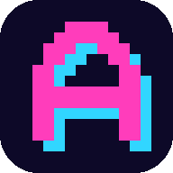
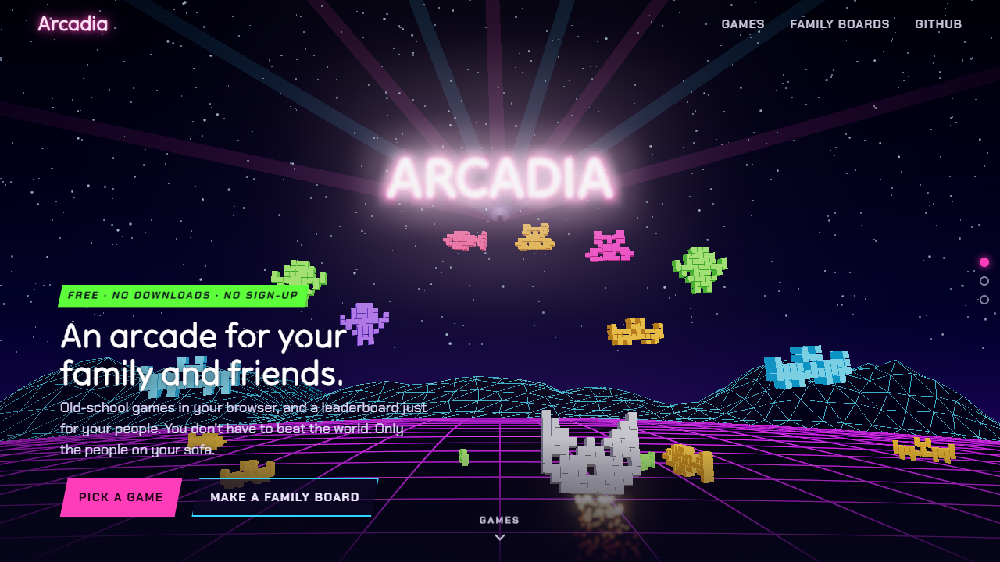
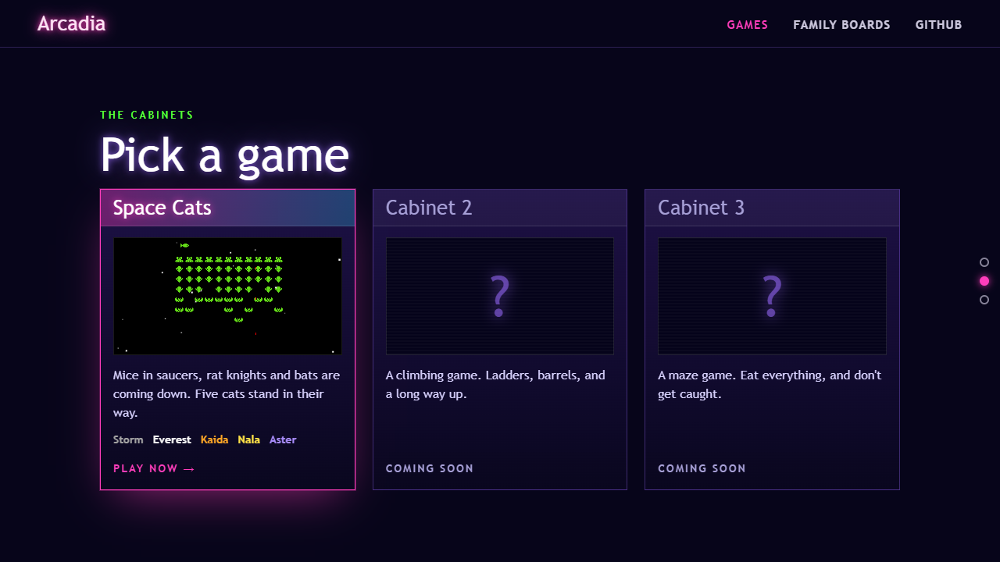
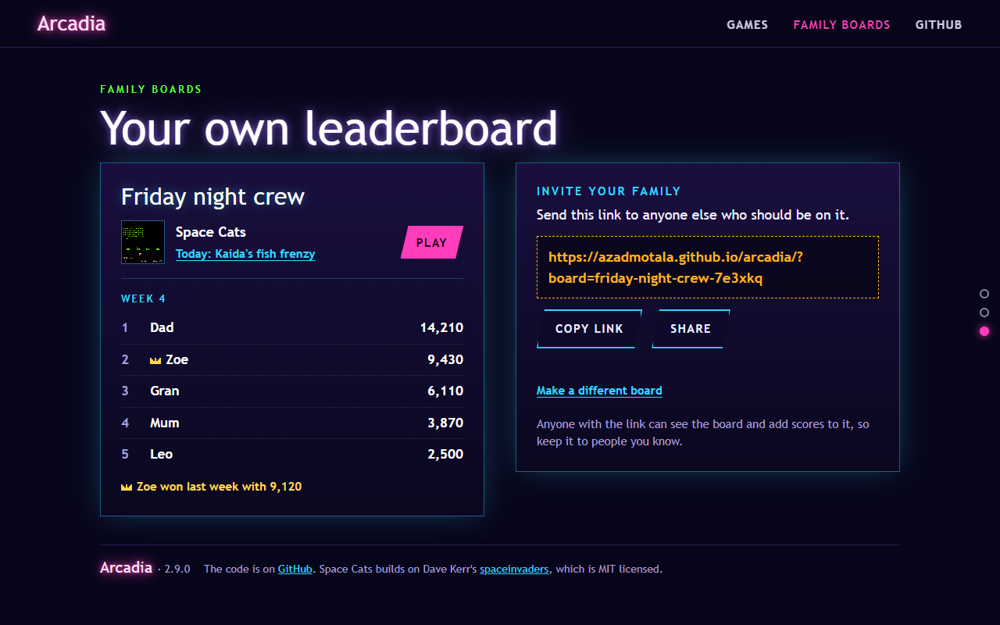

<div align="center">



# Arcadia

**Old-school arcade games that run in your browser, with a leaderboard just for your family and friends.**

<a href="https://azadmotala.github.io/arcadia/"></a>

[](LICENSE)

<a href="https://azadmotala.github.io/arcadia/"></a>

</div>

Somebody out there has a high score you'll never touch. Arcadia doesn't make you chase it. Make a board for your family or friends, send them the link, and the score to beat is your sister's.

Everything runs in the browser, on phones, tablets and computers. There's nothing to install and nobody signs up.

## The home page

The home page works like a slide show: three full screens, and each scroll or swipe snaps to the next.

1. **The arcade at night.** A neon grid floor rolls towards you under wireframe mountains, and the Arcadia sign glows in the sky with light fanning out behind it. Space Cats' fleet floats in an arc under the sign, built in coloured blocks from the game's own pixel art. A cat flies in from the front and picks them off, and every few hits it spins round and the next of the five cats takes over. On a computer, the view leans as you move the mouse.
2. **The cabinets.** Each game has a cabinet. Space Cats is open, and two locked cabinets hint at what's coming: a climbing game and a maze game. On a computer the cabinets lean towards the pointer.
3. **Family boards.** The board this device is on, live: today's challenge, this week's top players and last week's champion, with its link to send to the family. Or make a new board.

The header stays at the top on every slide. It's see-through over the scene and darkens once you scroll, and the link for the slide you're on lights up pink. Dots down the right-hand side show where you are, and take you to any slide.



It's built to work for everyone:

- **On phones**, the words sit over the foot of the scene and the view tilts down so the cat stays in sight above them. The cabinets swipe sideways, and on shorter screens a few extras drop out so each slide still fits.
- **With Reduce Motion switched on**, as on many iPhones, the scene runs a calm version: everything moves at about a third of the speed, with no shooting, spinning, flicker or leaning.
- **Without WebGL**, or if the 3D library can't load, the page shows the Arcadia name on its own after a few seconds.

## The games

| Game | |
|---|---|
| [**Space Cats**](https://azadmotala.github.io/arcadia/games/space-cats/) | Mice in flying saucers, rat knights and bats march down on five cats. Pick your cat, shelter behind the moon rocks, and earn the last two cats by scoring points. Every day there's a new three-wave challenge too, played as the day's cat with its own twist. [How to play](games/space-cats/README.md) |

More games are on the way. Each one lives in its own folder under `games/`.


## Family boards

A board is a private code that sits at the end of a link, like `https://azadmotala.github.io/arcadia/?board=friday-night-crew-7e3xkq`.

1. Make one on the [home page](https://azadmotala.github.io/arcadia/#boards). Give it a name, and a few random letters go on the end so nobody can guess it.
2. Send the link to the family or your friends.
3. Everyone who opens it is on the board. Their device remembers it, and their scores in each game go on that game's weekly top 10.

When a score makes the board, the game asks who played. Each board has its own players, by three letters like the initials on an arcade machine, shared by every game and device on it: tap yours, or add yourself the first time. Anyone with the link can see them. Each top 10 shows every player once, with their best.

Every board starts again at midnight on Monday, South African time. Each game shows this week's top 10 with a crown for last week's winner, and the all-time top 10 is a tap away. When a game ends, Share sends the result to the family chat, with a link back to the board.

Space Cats also has a new challenge every day, the same waves for everyone, played as the day's cat with its twist until your cats run out, with its own **Today** top 10 and a star for yesterday's winner ([Space Cats' README](games/space-cats/README.md#todays-challenge) has the details).

A board's name comes from its code, so `friday-night-crew-7e3xkq` shows as **Friday night crew**: in the invite when someone opens the link, on the home page, and above the Space Cats top 10s. A board made without a name shows its code instead.

On a device that's on a board, the Family boards slide shows the board as a live card: its name, today's challenge (a link that opens it), which week of its championship this is (week 1 is the week of its first score), this week's top players, and last week's champion with a crown, with a Play button. Phones show the top 3, so the slide fits one screen; taller phones and computers show the top 5.



Any device that's on a board can send the link again: beside the card (below it on phones) is the link, a Copy button, and a Share button on devices that can share. Making a different board is tucked behind a button underneath.

Lost the link? Any device that's still on the board has it on the Family boards slide. As the owner of the Firebase project, you can also see every board's code in the [Firestore data page](https://console.firebase.google.com/project/arcadia-63980/firestore/databases/-default-/data), under **boards**. Nobody else can look a board up without its code.

Anyone with the link can see the board and add to it, so keep it to people you know. A board doesn't need setting up anywhere: it starts the first time someone posts a score to it.

## The icon

Arcadia's icon is a pink pixel A with a cyan edge on a dark square, drawn on a 16 by 16 grid. Browser tabs use `assets/favicon.svg`, which stays sharp at any size. The PNGs are for older browsers (`favicon-32.png`), iPhone home screens (`apple-touch-icon.png`) and Android (`icon-192.png`, `icon-512.png` and `icon-maskable-512.png`, listed in `manifest.webmanifest`). Space Cats keeps its own green cat icon.

## Run it locally

Serve the repo with any static web server. With Python:

```bash
git clone https://github.com/azadmotala/arcadia.git
cd arcadia
python -m http.server 8000
```

Then open http://localhost:8000. There's nothing to build. GitHub Pages serves the `main` branch as it is.

## Project layout

```
arcadia/
├── index.html              The home page: the scene, the cabinets and the family boards
├── waiting.html            A help page, linked from nowhere, for scores that stay grey
├── assets/
│   ├── arcadia.css         The neon look, the slides, the header and the cabinets
│   ├── arcadia.js          Family boards and their live card, links between slides, the dots and the header
│   ├── scene.js            The 3D scene, drawn with three.js
│   ├── favicon.svg         The pixel A icon, with PNG versions beside it
│   ├── manifest.webmanifest  Name and icons for adding Arcadia to a home screen
│   └── space-cats.png      The picture on the Space Cats cabinet and the board card
├── games/
│   └── space-cats/         Space Cats, with its own README
├── docs/                   Pictures for the READMEs
├── firestore.rules         Who can read and add players and scores
├── firestore.indexes.json  The index for the weekly top 10 of initials scores
├── firebase.json           Tells the Firebase CLI where the rules and index are
└── .firebaserc             Arcadia's Firebase project
```

## How the home page works

- **The scene.** `assets/scene.js` loads [three.js](https://threejs.org) 0.160.0 from unpkg, through the import map in `index.html`, and adds a glow on top. Its creatures and cats come from Space Cats' own script, `games/space-cats/js/spacecats.js`, which the page loads first. Change a cat there and the home page follows.
- **The board card.** The home page also loads Space Cats' `js/leaderboard.js`, the same code the game uses, so the card shows exactly what the game's board does, including scores from this device still waiting to go up. It shows the board as last seen straight away, then fetches the latest, and again when someone comes back to the page. Today's challenge comes from `spacecats.js`, which the page already loads, so the card and the game always agree on the day's cat.
- **The fonts.** Headings and the sign use [Tilt Neon](https://fonts.google.com/specimen/Tilt+Neon), and the rest uses [Chakra Petch](https://fonts.google.com/specimen/Chakra+Petch), both from Google Fonts.
- **The slides.** They snap with CSS scroll snapping. Safari on iPhone can pull the page straight back when a link jumps across snapping slides, so `assets/arcadia.js` handles links to the page's own slides itself. It switches snapping off for the jump, glides there, and switches it back on once it arrives, finishing the jump itself if the glide stalls.
- **What a device remembers.** The board code is kept in the browser as `arcadia.board`, shared by the home page and every game, along with the anonymous sign-in (`arcadia.auth`), the last player on each board (`arcadia.lastPlayer`) and new players waiting to go up (`arcadia.pendingPlayers`). Each game keeps its own things under its own name, like Space Cats' high score, `arcadia.space-cats.highScore`, its waiting scores and its best this week and today.
- **A score that stays grey.** Open [waiting.html](https://azadmotala.github.io/arcadia/waiting.html) on that device. It lists the players and scores the device is still waiting to send, and **Send now** tries again with the game's own code, showing each request and what the board said back. Sign-in tokens are never shown.
- **Releasing a change.** Change the `?v=` on the links in `index.html` for any file you've changed, so browsers fetch the new version. The footer shows the page's version, read from the `?v=` on the `arcadia.js` link, so keep the three home page links on the same number. GitHub Pages also keeps pages for up to 10 minutes, so a reload may be needed to see a release.

## The leaderboards

Scores are kept in Firestore, in Arcadia's own Firebase project, `arcadia-63980`, with the database in Johannesburg (`africa-south1`). Players sign in anonymously without noticing, and that's all it takes to post a score.

A board's players are at `boards/{code}/players/{player}`, each with a name and when they were added. Each game keeps its own scores on the board, under `boards/{code}/games/{game}`:

- `plays/{id}`: every game that made the board, with who played, their name, the score, when, and the week.
- `bests/{player}`: each player's best ever. The all-time top 10 is the highest of these.
- `weeks/{week}/bests/{player}`: each player's best that week. The week's top 10 is the highest of these, and last week's winner is the top one from the week before.
- `days/{day}/bests/{player}`: each player's best in that day's challenge. Days are numbered from 1 January 1970 and start at midnight in South Africa. One played offline can go up for a day after its day ends.
- `scores/{id}`: scores from before players, by three-letter initials. They still show, one row for each set of initials.

The rules in [`firestore.rules`](firestore.rules) let anyone read a board they know the code of, and let a signed-in game add well-formed players and scores to it. Nothing can be deleted, and the only change allowed is a player's best going up.

Each score says which week it was played in, numbered from Monday 5 January 1970, with weeks starting at midnight on Monday in South Africa (UTC+2). The rules check the week matches when the score was played, and turn away a score more than 3 days after its week has ended, so one played offline can still go up a little late. The weekly top 10 of initials scores needs the index in [`firestore.indexes.json`](firestore.indexes.json). Scores from before weeks were added have no week, so they only count towards the all-time top 10.

To publish the rules and the index after changing them, with the [Firebase CLI](https://firebase.google.com/docs/cli):

```bash
firebase deploy --only firestore
```

### Adding a game

1. Put it in its own folder under `games/`.
2. Copy Space Cats' `js/leaderboard.js` and set `GAME` to the new game's name.
3. Add that name to `isGame` in `firestore.rules` and publish the rules.
4. Give it a cabinet on the home page: copy the Space Cats cabinet in `index.html` over one of the Coming soon cabinets.

The board code, its players, this device's last player and the anonymous sign-in are shared by every game, so a family board works across all of them.

## Credits

Space Cats builds on [spaceinvaders](https://github.com/dwmkerr/spaceinvaders) by Dave Kerr, which supplies its game engine, its starfield and its core gameplay. The home page's scene uses [three.js](https://threejs.org) (MIT licence). Tilt Neon and Chakra Petch are under the SIL Open Font License. The cats are named after ours.

## License

[MIT](LICENSE). The original spaceinvaders code is also MIT, and its copyright notice is kept in the LICENSE file.
