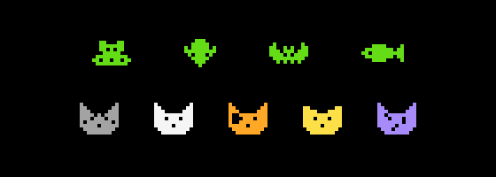
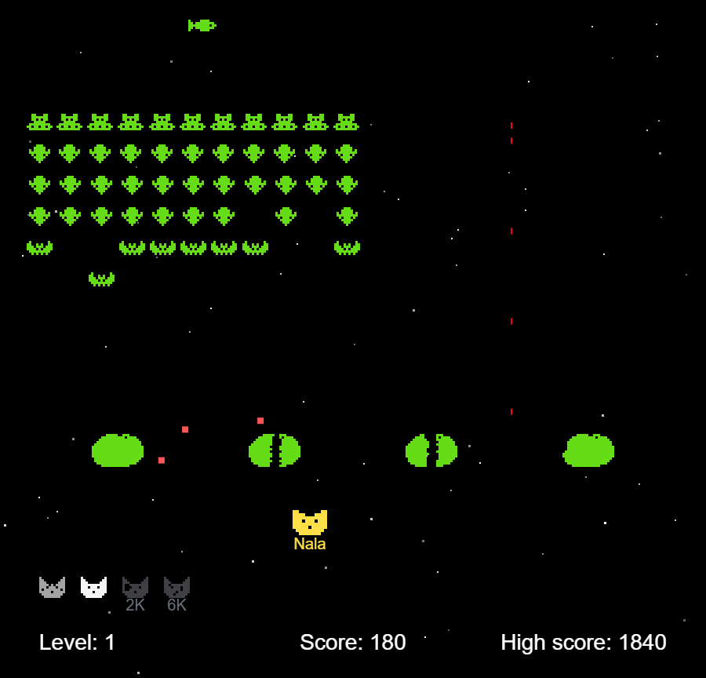
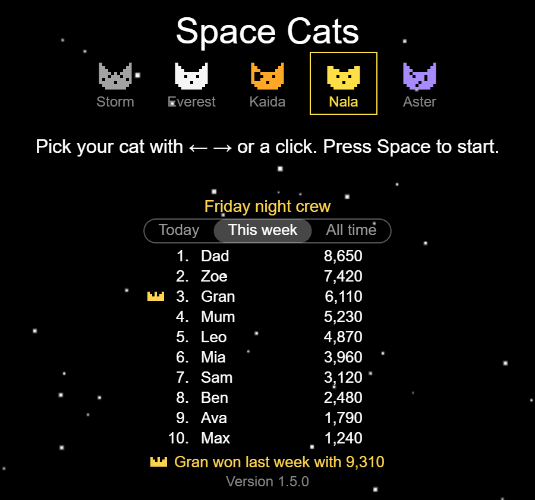

<div align="center">



# Space Cats

**Five cats, one fleet of mice, rats and bats. Clear the sky and they come back faster.**

<a href="https://azadmotala.github.io/arcadia/games/space-cats/"></a>


[](../../LICENSE)

<a href="https://azadmotala.github.io/arcadia/games/space-cats/"></a>

[How to play](#how-to-play) · [Family leaderboard](#family-leaderboard) · [Run it locally](#run-it-locally) · [Tweak it](#tweak-it) · [Credits](#credits) · [License](#license)

</div>

## The game

A fleet of mice in flying saucers, rat knights and bats marches side to side, drops a row every time it hits the edge, and bombs you on the way down. You're a cat. Shoot every last one of them and the next wave turns up faster, bigger and quicker to bomb. Let them reach the bottom and it's over.

You have five cats: Storm, Everest, Kaida, Nala and Aster. Pick one on the start screen and it goes first. Two more wait their turn, and you earn the last two by scoring points. When a bomb hits your cat, it floats home and the next one takes over.

Every so often a fish swims across the top. Shoot it for a mystery score.

Four moon rocks stand between you and the fleet. Bombs blast holes in them from above and your own shots blast them from below, so they wear away as you play, and the fleet crushes whatever it marches into. You get fresh rocks with every wave.

Everything in the fleet is green. Switch on random colours and every wave turns up in a different colour from the last.

## How to play

Space Cats is the first game on **[Arcadia](https://azadmotala.github.io/arcadia/)**: pick it from the cabinets on the home page, or go straight to **[the game](https://azadmotala.github.io/arcadia/games/space-cats/)**. Nothing to install. On a phone or tablet, the game fills the screen and you steer with your thumb.

To keep it on your home screen, open the game and tap Share → **Add to Home Screen** on an iPhone or iPad, or choose **Add to home screen** from Chrome's ⋮ menu on Android. It gets a green cat as its icon.

| | Computer | Phone or tablet |
|---|---|---|
| Pick your cat | <kbd>←</kbd> <kbd>→</kbd>, or click a cat | Tap a cat |
| Start | <kbd>Space</kbd> | Tap anywhere else |
| Move | <kbd>←</kbd> <kbd>→</kbd> | Drag anywhere on the screen. Your cat follows your finger and stops when you let go |
| Fire | <kbd>Space</kbd> (hold it down to keep firing) | Keep your finger down |
| Pause | <kbd>P</kbd> or the **Pause** button | **Pause** button, or switch to another app |
| Sound on/off | **Mute** button | **Mute** button |
| Fleet colours | **Random colours** button | **Random colours** button |
| Back to Arcadia | **Back to Arcadia** link under the game | **‹ Arcadia** in the top corner of the start screen |

On a computer the buttons sit under the game. On a phone or tablet they're in the top corner. The game also pauses itself when you switch to another tab or app, and goes quiet until you come back.

When a game ends, the next press or tap takes you back to the start screen, so whoever plays next can pick their own cat. The game remembers the last cat picked on each device.

The start screen shows which version you're playing. If you think you're on an old one, reload the page. On a phone, use the reload button in the address bar, since pulling down to refresh doesn't work in the game.

### Rules

- You start with three cats: the one you picked and the next two. The two waiting their turn sit in the bottom-left corner.
- The other two cats are shown in grey with the score that brings them in. At 2,000 points the fourth cat joins, and at 6,000 the fifth. That's five lives if you get there.
- Each bomb that hits your cat sends it home and the next cat takes over. When the last cat goes home, the game's over.
- If the fleet reaches the bottom or runs into your cat, the game ends right there.
- Mice are worth 40 points, rat knights 20 and bats 10. Clear a wave and you get a bonus of 50 × that level.
- The fish is usually worth 100, often 200, and now and then 300 or 500. It comes every 15 to 30 seconds, but not once the fleet is down to its last 7.
- Your high score is saved in your browser on that device, the moment you beat it. It shows during play, on the start screen and when the game ends. On a family board, the end of a game compares it with your best this week instead, to match the weekly top 10: **New best this week!**, or what your best this week is.

### Family leaderboard

The game can keep a top 10 shared by a family or group of friends, on any device. It starts again every Monday at midnight (South African time), and last week's winner gets a crown. Make a board on the [Arcadia home page](https://azadmotala.github.io/arcadia/#boards) and send its link to everyone who should be on it. Each device remembers the board after opening the link once, and every Arcadia game uses it. Only people who know the link can see the board or add to it.

The board's name heads it on the start screen and when a game ends. A board made as "Friday night crew" shows **Friday night crew**; one made without a name shows **Leaderboard**. Under the name, a two-way switch, **This week** and **All time**, changes which top 10 it shows; tap or click either side. On a computer, the pointer turns into a hand over anything on the screen you can click, the cats and the switch. Below this week's scores is who won last week, and if they're on the board again this week, their crown sits beside them.



- When a score makes this week's top 10, you're asked for your initials: three letters. The last ones used on that device are filled in, so on a shared computer type over them.
- The first time a device opens a board, it offers its best score from this week.
- No connection? A score that makes the board waits on the device, shown in grey, and goes up when the board can be reached again. The game plays the same either way. If it can't get through within 3 days of the week ending, it's dropped.
- When a game ends, **Share** sends how it went to the family chat, like "Friday night crew · Space Cats · 2nd this week with 3870, 340 behind DAD", with a link straight to the game on your board. Phones open their share sheet; on a computer it's copied, ready to paste. A score that isn't on this week's board is shared as just the points and the level.
- Need the link again? Any device that's on the board shows it on the Family boards slide of the Arcadia home page, with a Copy button, and Share on devices that can share. [Arcadia's README](../../README.md#family-boards) has more on boards.

### It gets harder

Every level, the fleet moves faster, drops bombs more often, and the bombs fall faster. The fleet gets bigger too. You get a faster trigger finger to keep up.

The fleet and your fire rate stop growing at level 25. The fleet's speed doesn't.

Within each wave, the fleet speeds up as you thin it out. It's gentle at first: with half of it left it's about 1.4 times as fast, and with a quarter left twice as fast. The last few move three times as fast as the full fleet did. Its footsteps, a low tick and tock, speed up with it, up to eight a second.

## Run it locally

Space Cats lives in Arcadia's repo, in `games/space-cats/`. Serve the repo with any static web server and open the game's folder. With Python, from the top of the repo:

```bash
git clone https://github.com/azadmotala/arcadia.git
cd arcadia
python -m http.server 8000
```

Then open http://localhost:8000/games/space-cats/. There's nothing to build: GitHub Pages serves the repo as it is.

## Tweak it

All the tuning sits in the `config` object in [`js/spacecats.js`](js/spacecats.js). The fleet, bomb and fire-rate numbers are base values that grow with each level.

| Setting | Default | What it changes |
|---|---|---|
| `invaderInitialVelocity` | `25` | How fast the fleet moves |
| `bombRate` | `0.05` | How often the front row drops bombs |
| `invaderRanks` / `invaderFiles` | `5` / `10` | Rows and columns in the fleet |
| `shipSpeed` | `120` | How fast your cat moves |
| `rocketMaxFireRate` | `2` | Shots per second |
| `levelDifficultyMultiplier` | `0.2` | How much harder each level gets |
| `invaderSpeedUpMax` | `3` | How much faster the last of the fleet gets (`1` turns the speed-up off) |
| `fishMinInterval` / `fishMaxInterval` | `15` / `30` | Seconds between fish |
| `fishSpeed` | `70` | How fast the fish swims |
| `touchShipSpeed` | `360` | Top speed of your cat when you drag it on a touch screen |
| `shieldCount` | `4` | How many moon rocks there are (`0` for none) |
| `startCats` | `3` | How many cats a game starts with |
| `bonusCatScores` | `[2000, 6000]` | The scores that bring in each of the other cats (`[]` for none) |

The cats are in `CATS`, near the top of the same file. Change a cat's name, colour or face there, or change the order the others follow yours. The faces are pixel grids in `CAT_FACES`: plain, tabby, blaze, folded ears, spots and an eye patch.

The fleet is drawn in code too. `INVADER_TYPES` holds each kind's pixel grids for its two poses and how many points it's worth. Edit a grid to redraw one, or add colours to `INVADER_COLOURS`. The fish (`FISH_PIXELS`) and the moon rocks (`SHIELD_PIXELS`) are drawn the same way. All the sounds are made in code as well, in the `Sounds` part of the file, so there are no sound files.

Add `?debug=true` to the URL and the game outlines the play area.

### The leaderboard's Firebase project

The leaderboard is kept in Arcadia's Firebase project, which every Arcadia game shares. `js/leaderboard.js` names the project (`API_KEY` and `PROJECT_ID`); those identify it and are meant to be public. `GAME` is this game's name there, so its scores stay apart from other games'. What can be read and added is decided by [`firestore.rules`](../../firestore.rules) at the top of the repo; Arcadia's README says how to publish them.

### Releasing a version

Set the new version in the `?v=` at the end of each stylesheet and script link in `index.html`. The `?v=` makes browsers load the new files instead of older cached copies, and the start screen reads its version from there.

## Project layout

```
games/space-cats/
├── index.html            Page, canvas, input handling and touch-screen layout
├── js/
│   ├── spacecats.js      Game loop, cats, fleet, fish, moon rocks, scoring and sound
│   ├── leaderboard.js    Weekly family leaderboard in Firebase, with a queue for offline play
│   └── starfield.js      Scrolling star background
├── css/                  Page styles
└── icons/                Browser tab and home-screen icons, and the web app manifest
```

## Credits

Space Cats is based on [spaceinvaders](https://github.com/dwmkerr/spaceinvaders) by Dave Kerr, which supplies the game engine, the starfield and the core gameplay. This version adds the cats and picking which one you play as, bonus cats that join as you score, a fleet of mice, rat knights and bats drawn in code with their marching poses and points, the fish, the moon rocks, sounds made in code, the speed-up, a saved high score, a family leaderboard, an option to give every wave a new colour, Pause, Mute and Share buttons, and touch controls for phones and tablets.

The cats are named after ours.

## License

[MIT](../../LICENSE). The original spaceinvaders code is also MIT, and its copyright notice is kept in the LICENSE file.
